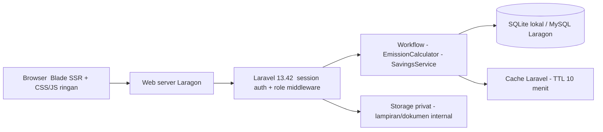

# Arsitektur PaperLess Campus

## Lapisan

- `routes/web.php`: URL bernama, autentikasi, throttling, akses role.
- Controllers: validasi request, query berhalaman, authorization, render Blade.
- `SubmissionWorkflow`: transaksi, lock status, append-only approval/timeline, finalisasi sekali.
- `EmissionCalculator`: perhitungan murni dan teruji; `SavingsService`: agregasi DB yang di-cache.
- Migration bisnis bersifat aditif: users ditambah role/NIM/unit/aktif; tabel layanan, submissions, lampiran, approval, event, dokumen final internal, faktor, revisi faktor.
- Upload dan keluaran akhir disimpan pada disk `local` (`storage/app/private`) dan harus lewat controller ber-policy.

## Keputusan

- Versi framework lokal Laravel 13.42 dipertahankan; laporan kelompok yang menyebut Laravel 11 perlu diselaraskan.
- SQLite yang aktif pada `.env` dipertahankan. MySQL Laragon dapat dipakai dengan mengubah `DB_CONNECTION`/kredensial secara lokal.
- Seeder demo idempoten; ia menambah contoh hanya jika tabel pengajuan kosong. Tidak ada `migrate:fresh` atau penghapusan data.
- Dokumen final adalah PDF satu halaman dari generator internal PHP tanpa package tambahan. File privat digenerate sekali pada approval final dan bukan TTD tersertifikasi.
- GSE: SSR, pagination 15, indeks query, kalkulasi cache 10 menit dengan invalidasi saat approval/faktor berubah, tema sistem tanpa font CDN. Cache response privat tidak dibuat publik.

